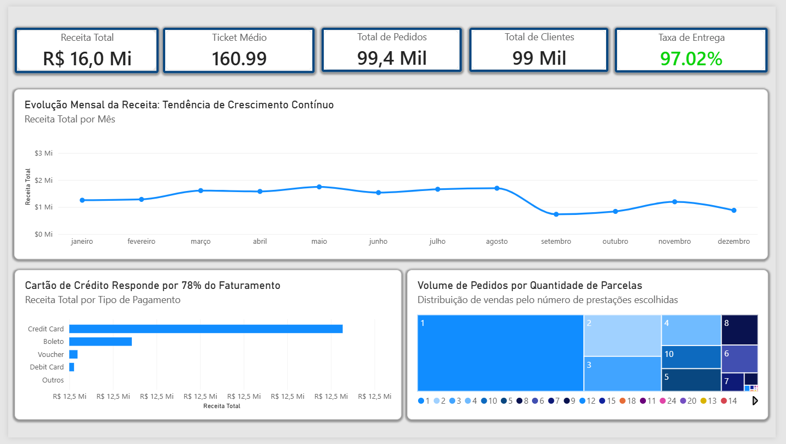
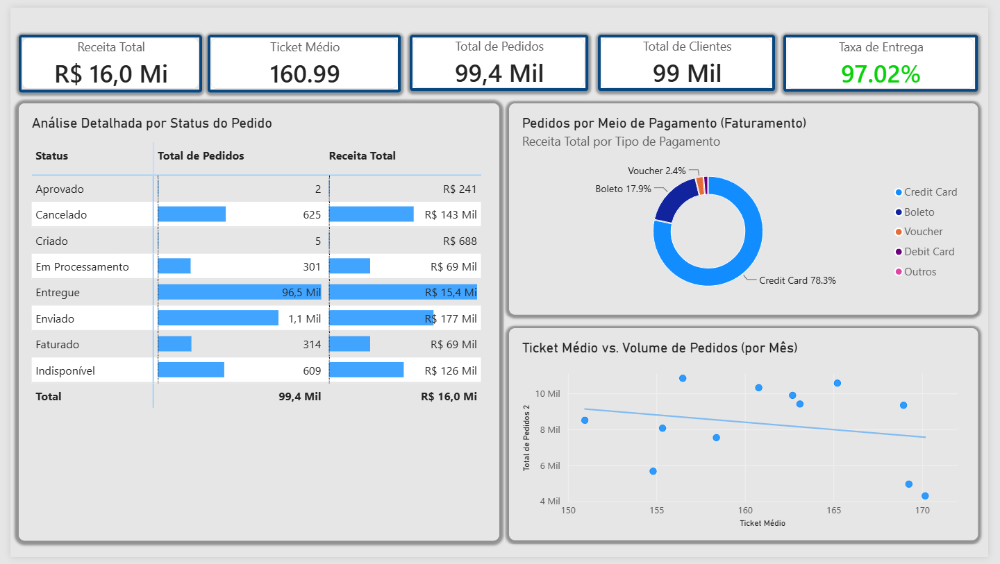
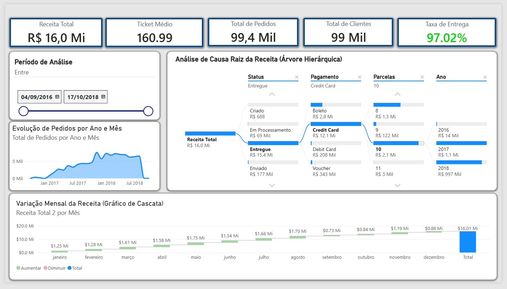

# 📊 E-Commerce Analytics: Olist Brazilian Market


> 🌐 **Acesse a vitrine interativa do projeto:** [vrsmarcos26.github.io/ecommerce-analytics-powerbi-olist](https://vrsmarcos26.github.io/ecommerce-analytics-powerbi-olist/) *(disponível em PT-BR / EN com modo claro e escuro)*

---

## 📌 Visão Geral do Projeto
Este projeto de Ciência de Dados analisa o comportamento operacional, logístico e financeiro do e-commerce brasileiro utilizando o banco de dados público da **Olist** (via Kaggle). O objetivo foi aplicar o ciclo completo da metodologia **KDD (Knowledge Discovery in Databases)** — da extração e limpeza à visualização executiva — estruturando mais de **20 KPIs estratégicos** em um dashboard interativo de 3 camadas no Power BI.

Projeto desenvolvido como trabalho de conclusão da disciplina de Ciência de Dados do **Centro Universitário de Brasília (CEUB)**.

---

## 🛠️ Ferramentas e Metodologia
* **Metodologia KDD:** Seleção, pré-processamento, transformação, mineração de padrões e interpretação de resultados.
* **Microsoft Power BI:** Construção do dashboard e arquitetura de visualização em 3 níveis (*Executiva*, *Analítica* e *Exploratória*).
* **Power Query (M):** Pipeline de ETL, tratamento de valores nulos, tipagem e modelagem relacional.
* **Linguagem DAX:** Criação de medidas dinâmicas, inteligência de tempo, cálculos iterativos e formatação condicional.
* **Front-end (HTML5 / CSS3 / JS):** Página web responsiva (`index.html`) hospedada via GitHub Pages para embarcar o relatório público do Power BI.

---

## 🗂️ Arquitetura de Dados & Estrutura do Repositório

Foram utilizados dois datasets principais integrados via chave relacional (`order_id`):
1. `olist_orders_dataset`: Histórico de status dos pedidos, carimbos de tempo e desempenho logístico.
2. `olist_order_payments_dataset`: Transações financeiras, parcelamentos e meios de pagamento.

**Volume Analisado:** ~99,4 mil pedidos validados, totalizando **R$ 16,0 Milhões** em receita bruta.

```text
ecommerce-analytics-powerbi-olist/
├── Projeto_CD.pbix     # Arquivo fonte do Power BI com dados embarcados e medidas DAX
├── index.html          # Página web executiva (bilíngue PT/EN + Dark/Light mode)
├── Executivo.png       # Captura da camada 1: Visão Executiva
├── Analitico.png       # Captura da camada 2: Visão Analítica
├── Exploratico.png     # Captura da camada 3: Visão Exploratória
├── LICENSE             # Licença do repositório
└── README.md           # Documentação do projeto
```

---

## 📈 Estrutura do Dashboard

### 1. Visão Executiva (Estratégico)
Foco em faturamento total, ticket médio, volume de pedidos e comportamento macro dos meios de pagamento.



### 2. Visão Analítica (Tático e Correlações)
Detalhamento de gargalos logísticos, taxas de conversão por status e análise de regressão linear (*Ticket Médio vs. Volume de Pedidos*).



### 3. Visão Exploratória (Causa Raiz)
Análise interativa com **Árvore Hierárquica** em 4 níveis (*Status > Meio de Pagamento > Parcelas > Ano*) e **Gráfico de Cascata** para variação mensal.



---

## 💡 Principais Insights Extraídos

| Pilar Estratégico | Indicador-Chave | Diagnóstico & Recomendação |
| :--- | :--- | :--- |
| **Eficiência Logística** | **97,02%** de entrega | Alta confiabilidade operacional em uma base de **99,4 mil pedidos** (~96,5 mil entregas concluídas), com cancelamentos controlados abaixo de **0,7%**. |
| **Hegemonia do Crédito** | **78,3%** do faturamento (**R$ 12,1 Mi**) | Forte dependência do Cartão de Crédito (com destaque para parcelamentos em até 10x), reforçando a importância de políticas de crédito e parcelas sem juros. |
| **Decisão Estratégica (Cross-selling)** | Tickets **> R$ 160** | A análise de correlação indica que picos de ticket médio comprimem o volume de pedidos, apontando oportunidades para campanhas de *cross-selling* e combos complementares. |

---

## 🚀 Como Visualizar ou Executar o Projeto

### Opção 1 — Online (Sem instalação)
Acesse diretamente a página interativa no navegador:  
👉 **[https://vrsmarcos26.github.io/ecommerce-analytics-powerbi-olist/](https://vrsmarcos26.github.io/ecommerce-analytics-powerbi-olist/)**

### Opção 2 — Localmente no Power BI Desktop
1. Clone este repositório:
   ```bash
   git clone https://github.com/vrsmarcos26/ecommerce-analytics-powerbi-olist.git
   ```
2. Certifique-se de ter o [Microsoft Power BI Desktop](https://powerbi.microsoft.com/desktop/) instalado (gratuito).
3. Abra o arquivo `Projeto_CD.pbix`.
4. Os dados já estão embarcados no modelo — navegue pelas abas inferiores para explorar cada camada.

---

## 👨‍💻 Autor

**Marcos Vinícius** — Analista de Dados / Desenvolvedor de BI  
[](https://vrsmarcos26.github.io/)
[](https://www.linkedin.com/in/vrsmarcos26)
[](https://github.com/vrsmarcos26)
[](https://www.instagram.com/_marcos.vrs/)
